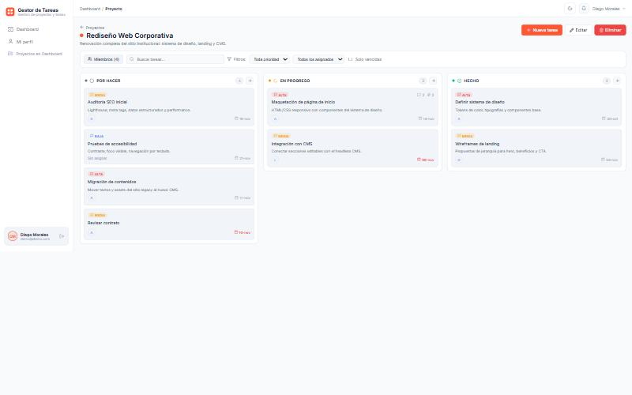
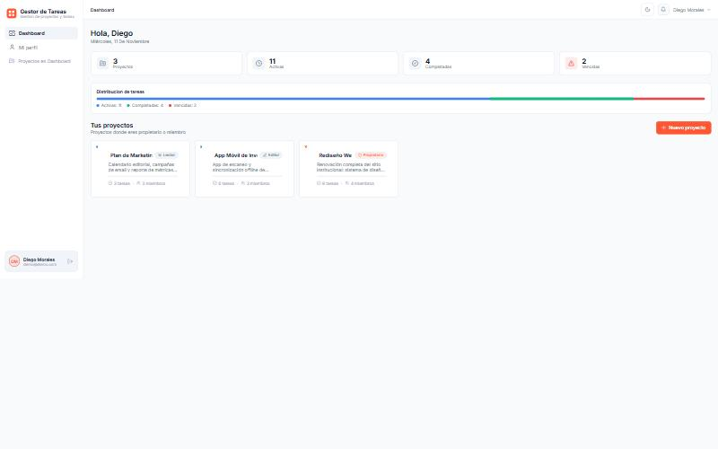
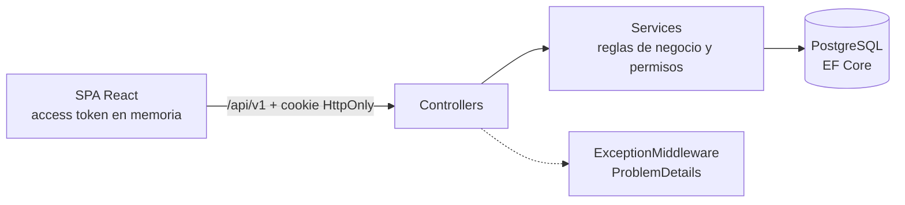
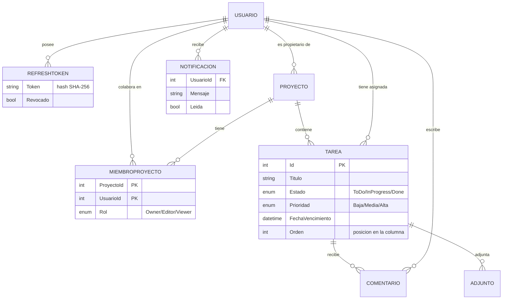

# Gestor de Tareas — API

API REST de un gestor de proyectos y tareas tipo Trello: proyectos con roles (Owner / Editor / Viewer), tablero Kanban con orden propio, comentarios, adjuntos, avisos de asignación y autenticación JWT con refresh token en cookie HttpOnly.

Es una de las dos repos del proyecto; el cliente está en [gestor-tareas-spa](https://github.com/Joel-S-Florian/gestor-tareas-spa). **Es un proyecto solo para ejecutar en local** (ver [ADR 003](docs/decisiones/003-sin-despliegue.md)): no tiene configuración de despliegue, y Swagger, las migraciones automáticas y los datos de demostración solo funcionan en Development.

| Tablero | Dashboard |
|---|---|
|  |  |

## Tecnologías

ASP.NET Core 8 (Web API) · Entity Framework Core 8 (Code First) · **PostgreSQL** (Npgsql) · JWT Bearer · Swagger · xUnit + `WebApplicationFactory`.

## Ejecutarlo en local

Requiere .NET SDK 8+ y PostgreSQL 14+.

```bash
# 1. Crear la base (ajusta usuario/clave en appsettings.Development.json si tu PostgreSQL los exige)
psql -U postgres -c "CREATE DATABASE gestor_tareas_dev"

# 2. Arrancar: en Development aplica las migraciones y siembra los datos de demostración
dotnet run --launch-profile GestorTareas.Api
```

La API queda en `https://localhost:52411` (Swagger en `/swagger`, salud en `/health`). El SPA la consume a través del proxy de Vite; ver su README.

### Configuración

| Clave (variable de entorno) | Uso |
|---|---|
| `ConnectionStrings__DefaultConnection` | Cadena de PostgreSQL. Obligatoria. |
| `Jwt__Secret` | Secreto de al menos 32 bytes. **Obligatorio: sin él la API no arranca.** El de desarrollo está en `appsettings.Development.json`. |
| `Auth__CookieSameSite` | `Lax` (por defecto), `Strict` o `None`. Ver [ADR 002](docs/decisiones/002-sesion-con-cookie-httponly.md). |
| `RateLimit__Auth__Permit` | Intentos por minuto y por IP en login/registro/refresh (10 por defecto). |
| `UploadsPath` | Carpeta de adjuntos (por defecto `Uploads`). |
| `CORS__AllowedOrigins` | Orígenes permitidos si el SPA no usa el proxy. |

## Usuarios de demostración (solo en Development)

Se siembran únicamente en desarrollo. No existen en ningún otro entorno.

| Email | Contraseña | Rol en Rediseño Web / App Móvil / Marketing Q3 |
|---|---|---|
| demo@demo.com | demo123 | Owner / Editor / Viewer |
| ana@demo.com | ana123 | Editor / Owner / — |
| luis@demo.com | luis123 | Viewer / — / Owner |
| joel@demo.com | joel123 | Editor / Editor / Viewer |

## Pruebas

```bash
dotnet test GestorTareas.Tests/GestorTareas.Tests.csproj
```

**50 pruebas de integración** que levantan la API real contra PostgreSQL (una base `gt_test_*` por ejecución). Usan `GT_TEST_PG` para apuntar a otro servidor (por defecto `Host=localhost;Username=postgres`). Cubren:

- **Matriz de roles:** Owner / Editor / Viewer × lectura, edición, tareas, comentarios, miembros y borrado; acceso de quien no es miembro y de quien no tiene token.
- **Sesión:** cookie HttpOnly, rotación del refresh token, detección de reuso, logout, límite de intentos y que el login "demo" fijo que existía ya no entra.
- **Adjuntos:** tipo, tamaño (5 MB), rol y comprobación de los primeros bytes del archivo.
- **Tablero:** orden dentro de la columna, mover entre columnas, filtro de vencidas, avisos de asignación y su privacidad.

La integración continua (GitHub Actions, `.github/workflows/ci.yml`) ejecuta las mismas pruebas con un servicio PostgreSQL 16.

## Endpoints (`/api/v1`)

| Método | Ruta | Descripción | Acceso |
|---|---|---|---|
| POST | `/auth/register` | Crear cuenta (fija la cookie de sesión) | Público, limitado por IP |
| POST | `/auth/login` | Devuelve el access token y fija la cookie | Público, limitado por IP |
| POST | `/auth/refresh` | Renueva el access token con la cookie y la rota | Cookie |
| POST | `/auth/logout` | Revoca el refresh token y borra la cookie | Cookie |
| GET / PUT | `/auth/perfil` | Ver / editar el perfil propio | Autenticado |
| GET / POST | `/proyectos` | Listar los míos / crear (el creador es Owner) | Autenticado |
| GET / PUT / DELETE | `/proyectos/{id}` | Detalle / editar (Owner, Editor) / eliminar (Owner, sin tareas) | Miembro |
| GET / POST | `/proyectos/{id}/miembros` | Listar / invitar por email | Miembro / Owner |
| PUT / DELETE | `/proyectos/{id}/miembros/{userId}[/rol]` | Cambiar rol / remover | Owner |
| GET | `/proyectos/{id}/tareas` | Paginado con `estado`, `prioridad`, `asignadoAId`, `vencidas`, `page`, `pageSize` (máx. 100) | Miembro |
| POST | `/proyectos/{id}/tareas` | Crear (al final de “Por hacer”) | Owner, Editor |
| GET / PUT / DELETE | `/tareas/{id}` | Detalle con comentarios y adjuntos / editar / eliminar | Miembro / Owner, Editor |
| PATCH | `/tareas/{id}/estado` | Cambiar de columna (queda al final) | Owner, Editor |
| PATCH | `/tareas/{id}/mover` | Cambiar de columna y de posición (arrastrar y soltar) | Owner, Editor |
| POST / DELETE | `/tareas/{id}/comentarios`, `/comentarios/{id}` | Comentar / borrar el propio | Miembro / Autor |
| POST / GET / DELETE | `/tareas/{id}/adjuntos`, `/adjuntos/{id}` | Subir (5 MB; imagen o PDF) / descargar / eliminar | Owner, Editor / Miembro |
| GET | `/notificaciones` | Mis avisos (últimos 30 y no leídos) | Autenticado |
| POST | `/notificaciones/{id}/leida`, `/notificaciones/leer-todas` | Marcar leídos | Autenticado |
| GET | `/health` | Estado | Público |

Errores como `ProblemDetails` (RFC 7807): 400 validación, 401 sin sesión, 403 sin permiso, 404, 409 conflicto de regla, 429 demasiados intentos.

## Reglas de negocio

- Solo se ve y edita un proyecto donde se es miembro. Owner: todo; Editor: tareas, no miembros ni borrar el proyecto; Viewer: solo lectura (puede comentar).
- No se elimina un proyecto con tareas, ni se remueve ni cambia el rol del propietario.
- Una tarea solo se asigna a un miembro del proyecto; asignarla avisa a esa persona (no a quien se la asigna a sí mismo).
- Adjuntos: máximo 5 MB; extensión, `Content-Type` y primeros bytes del archivo deben coincidir (JPEG, PNG, GIF, WebP, PDF).
- Contraseñas con el hasher de ASP.NET Core Identity; refresh tokens guardados solo como hash.

## Arquitectura



Los controladores son delgados; los permisos por rol están centralizados en `ProyectoService.ObtenerRolEnProyectoAsync` y se reutilizan en tareas, comentarios y adjuntos.



## Decisiones de diseño

| ADR | Resumen |
|---|---|
| [001](docs/decisiones/001-solo-postgresql.md) | PostgreSQL como única base de datos |
| [002](docs/decisiones/002-sesion-con-cookie-httponly.md) | Access token en memoria, refresh en cookie HttpOnly con hash y detección de reuso |
| [003](docs/decisiones/003-sin-despliegue.md) | El proyecto no se despliega |
| [004](docs/decisiones/004-pruebas-con-postgresql-real.md) | Pruebas de integración con la API real y PostgreSQL real |

El historial de la reconstrucción está en [docs/PLAN_MEJORAS.md](docs/PLAN_MEJORAS.md).

## Límites conocidos

- Sin confirmación de correo ni recuperación de contraseña: cualquiera puede registrarse con cualquier email.
- Los adjuntos se guardan en disco local, no en un almacén de objetos; en un entorno con disco efímero se perderían.
- Dos pestañas que renuevan la sesión en el mismo instante pueden disparar la detección de reuso y cerrar la sesión.
- Sin tiempo real: los avisos se consultan cada minuto desde el SPA.
- Los commits antiguos del historial contienen el login fijo y un secreto de desarrollo ya retirados; no son secretos reales.
